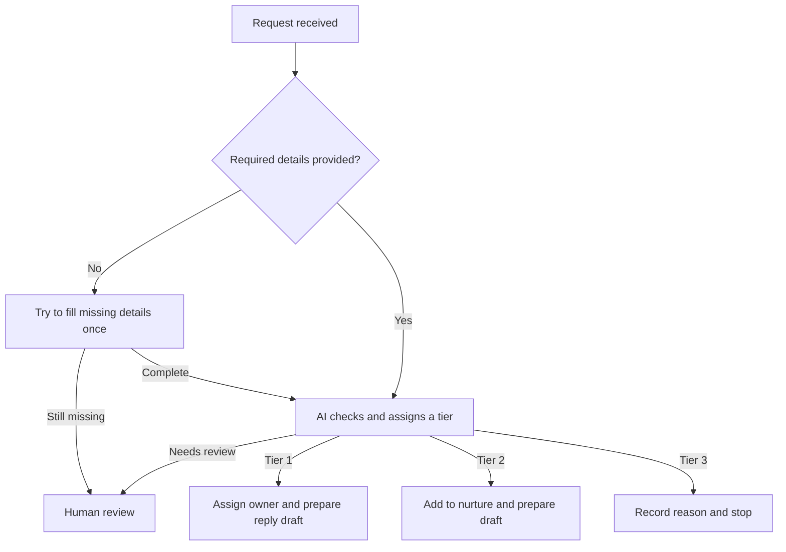

# Artifact templates

Each becomes a Notion sub-page of the project's master page. First line of every sub-page: `Status: DRAFT` → `Status: LOCKED YYYY-MM-DD`. Tag facts `[Real]`, `[Constructed]`, `[Mock]`.

## B-00 System Brief

~~~markdown
Status: DRAFT

# [Project name: the inspectable artifact]

**Track:** GTM / RevOps | Marketing Ops | Sales Ops | Engineering
**Company:** [name, URL]. [Constructed scenario elements labeled]
**Proves:** [2–3 recurring requirements from live postings, with links]
**Motion:** [Inbound: capture → qualify → route | Outbound: signal → enrich → score → engage | track equivalent]
**Stack:** [Claude Code + …] — [one line why]

## Company facts
| Fact | Value | Tag | Source |
|---|---|---|---|
| Niche | | Real | [url, accessed YYYY-MM-DD] |
| Offer + pricing | | Real | |
| ICP | | Real | |
| GTM motion | | Real / Constructed | |
| Visible stack | | Real | |
| Signals | | Real | |

## As-is bottleneck
[Where revenue leaks today, 2–3 sentences. Real evidence first, constructed parts labeled.]

## Value case (locked)
**Metric:** [pipeline | retention | CX | cost]
**Value claim:** [verb] [X] by ~[Y] for a [role] at a [company type]

| Assumption | Baseline | Tag | Source / reasoning |
|---|---|---|---|
| | | | |

**Most sensitive to:** [assumption]
**Pre-build estimate:** [number or range]

## MVP loop
[The smallest loop that clears all six gates]

## Cut line
- [Cut, not deferred]

## Definition of Done (project)
[One checkable statement: what exists, what happens when it runs, on what input.]

> Practice exercise. Any outreach drafted here is not to be sent.
~~~

## B-01 Context Sheet

~~~markdown
Status: DRAFT

## ICP hard bounds
| Dimension | In | Out | Tag |
|---|---|---|---|
| Firmographics | | | |
| Technographics | | | |
| Exclusions | | | |

## Signal taxonomy
| Signal | Intent | Weight | Source |
|---|---|---|---|

## Tier rubric (boolean)
- **Tier 1 (high touch):** [A AND B AND (C OR D)]
- **Tier 2 (automated sequence):** [...]
- **Tier 3 (disqualify):** [...]

## Production system prompt
```text
You are a [role] for [company]. Classify the record using only the rules below.
[ICP bounds] [signal taxonomy] [tier rubric]
If a required field is missing, return tier "needs_review". Never invent data.
Return only JSON: {"tier": "", "score": 0, "reasoning": "", "angle": ""}
```

## Test runs
[2 sample records → raw JSON output]
~~~

## B-02 Process Architecture

Chart labels: plain words, under ~8 words, no acronyms or tool names, one action per box. Keep the logic exact. Owners, deadlines and tool detail go in the text below the chart.

~~~markdown
Status: DRAFT

Design choice: [route by X, one sentence]. [What is cut.] [Mock/Constructed elements labeled.]



## What happens when something goes wrong?
[Per failure: what the system does, then where it lands (error queue, human review). Who reviews and by when.]

## What happens after routing?
[Per branch: the action, the owner (system or team), the deadline.]

## How fast should each step run?
[Plain list of step times.]

## What stays out?
[Cut, not deferred.]
~~~

## B-03 Data Schema

~~~markdown
Status: DRAFT

## Field dictionary
| Field | Type | Source | Transformation | Destination property | Tag |
|---|---|---|---|---|---|

## Input payload
```json
{}
```

## Output payload
```json
{}
```

## Sample records
[3–5: happy path, missing data, disqualify. Real company attributes, mock private fields, labeled]
~~~

## B-04 Build Spec

~~~markdown
Status: DRAFT

**Repo / workflow:** [link]
**Stack:** [...]

## 1. Ingestion
## 2. Enrichment and normalization
## 3. AI reasoning
## 4. Routing and action
[Per step: config, API calls, env vars by name only (never values), error handling]

## Recorded runs
| Run | Input | Output | Pass |
|---|---|---|---|
| Happy path | | | |
| Missing data | | | |
| Disqualify | | | |
~~~

## B-05 Case Study

See `proof-and-rubric.md` for the section specs.

~~~markdown
Status: DRAFT

# [Outcome-first hook]

## Estimate vs. result
## Problem and baseline
## Architecture (as built)
[Plain-language diagram: simple words, under ~8 words per label, detail in text below]
## Unit economics
## Governance runbook
## README
## Loom script (after Done)
## What I'd do differently
## Self-score
~~~
